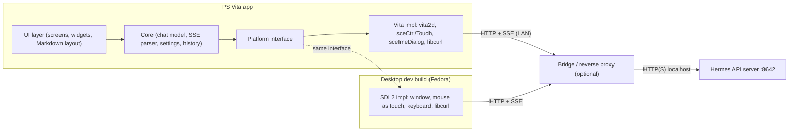

# PS Vita client for Hermes Agent: feasibility and implementation plan

> [!abstract] TL;DR
> - **Feasible, medium complexity.** A text chat client with streaming replies is a small project: about 1-2 weekends for an MVP if you know C or C++. A polished client with voice, camera and approvals is about 6-8 weeks part-time.
> - **The Vita is a better target than the 3DS.** It has a quad-core ARM, 512 MB RAM, a 960x544 screen, Wi-Fi n and a mature toolchain (VitaSDK).
> - **The only really hard problem is TLS and trust.** The Vita's system SSL stack and certificate store are old. So the Vita should talk **plain HTTP on your LAN** to a small **bridge/reverse proxy**, and the bridge handles TLS, auth and payload shaping. Details in [[#5. Limits and how to overcome them]].
> - **Recommended stack:** C++17 + VitaSDK + vita2d (rendering) + libcurl (HTTP/SSE) + yyjson or cJSON, with a **platform-independent core** that also builds as an SDL2 desktop app on Fedora. This lets you develop 80% of the app without touching the Vita.
> - **Assumption to confirm:** your Vita is already modded (HENkaku/Enso or equivalent). Without that, none of this runs. See [[#Open questions for you]].

> [!warning] Unverified items
> I could not find an existing Hermes Agent client for the 3DS (see [[#Sources]]). The Hermes API details below come from the official repo and third-party integration docs. Items marked **verify** should be checked against your Hermes version before you rely on them. The repo this document lives in was empty when I wrote it, so I have not inspected your Hermes setup.

---

## Table of contents

1. [[#1. What we are building]]
2. [[#2. Local dev environment on Fedora]]
3. [[#3. Technology choices]]
4. [[#4. Architecture]]
5. [[#5. Limits and how to overcome them]]
6. [[#6. Implementation plan (milestones)]]
7. [[#7. Complexity and effort estimate]]
8. [[#8. Risks]]
9. [[#9. Alternatives considered]]
10. [[#Open questions for you]]
11. [[#Sources]]

---

## 1. What we are building

A homebrew app (`.vpk`) for the PS Vita that is a **thin client for a Hermes Agent running elsewhere** (your PC, a server, a Raspberry Pi). The Vita does no AI work. It renders a chat UI and shows streamed answers.

### What Hermes gives us

Hermes Agent (Nous Research) can expose an **OpenAI-compatible HTTP API server**. From the docs I found:

| Item | Value | Status |
|---|---|---|
| Enable | `API_SERVER_ENABLED=true` and `API_SERVER_KEY=<secret>` in the Hermes env file, then `hermes gateway` | per Open WebUI docs, **verify** |
| Default port / bind | `8642`, `127.0.0.1` (localhost only) | **verify** |
| Base URL for clients | `http://<host>:8642/v1` | **verify** |
| Auth | `Authorization: Bearer <API_SERVER_KEY>`. Keys shorter than 16 chars reportedly make the API silently not serve. | **verify** |
| Endpoints we need | `GET /v1/models` (or a health route), `POST /v1/chat/completions` with `"stream": true` (SSE) | **verify** |
| Sessions | Unknown whether Hermes keeps server-side sessions per client. Fallback: the client sends the full message list each call, like any OpenAI client. | **verify** |

> [!tip]
> Because the API is OpenAI-compatible, the Vita client is also a generic OpenAI-compatible chat client. It will work against other backends too, which is handy for testing without a full Hermes install.

### Feature tiers

| Tier | Features |
|---|---|
| **MVP** | Settings (host, port, key), on-screen keyboard input, streamed text replies, scrollback, "new chat" |
| **v1** | Multiple conversations saved to `ux0:data/`, basic Markdown (headings, bold, code blocks, lists), error and reconnect handling, power-saving options |
| **v2** | Voice input (Vita mic, then speech-to-text on the bridge), TTS playback of replies, image attach from camera or memory card, tool-call / "agent is working" status line |
| **v3 (fun)** | Approve or deny risky agent actions from the Vita, rear-touch scrolling, gyro gestures, LiveArea notifications |

---

## 2. Local dev environment on Fedora

Goal: build a `.vpk` on Fedora, copy it to the Vita over FTP, launch it, read logs and crash dumps. In parallel, build the same app as a desktop SDL2 binary for fast iteration.

### 2.1 Packages

```bash
sudo dnf install -y \
  git cmake make ninja-build gcc gcc-c++ \
  python3 python3-pip \
  curl wget tar xz bzip2 unzip zip patch \
  pkgconf-pkg-config \
  SDL2-devel SDL2_ttf-devel libcurl-devel \
  lftp
```

- `SDL2-devel`, `SDL2_ttf-devel` and `libcurl-devel` are for the **desktop build** (see [[#4. Architecture]]).
- `lftp` is a convenient FTP client for pushing builds to the Vita.
- If the prebuilt VitaSDK binaries complain about a missing shared library, install the matching compat package (for example `ncurses-compat-libs`) or build the toolchain from source via the vitasdk buildscripts.

### 2.2 Install VitaSDK

The official route is **vdpm** (VitaSDK Package Manager), which bootstraps a prebuilt toolchain and installs ports of common libraries (libcurl, mbedTLS, freetype, vita2d, and so on).

I recommend installing under your home directory to avoid `sudo` for every update:

```bash
# 1. Environment (add to ~/.bashrc or ~/.zshrc)
export VITASDK="$HOME/vitasdk"
export PATH="$VITASDK/bin:$PATH"

# 2. Bootstrap the toolchain, then install the library packages
git clone https://github.com/vitasdk/vdpm ~/src/vdpm
cd ~/src/vdpm
./bootstrap-vitasdk.sh
./install-all.sh          # installs all ports; takes a while
                          # (or install only what we need, see below)

# 3. Sanity check
arm-vita-eabi-gcc --version
vita-mksfoex 2>&1 | head -1
```

> [!note]
> The vdpm README documents `/usr/local/vitasdk` as the default location. `VITASDK` is what the build tooling reads, so a home-directory path works as long as it is exported. One gist I found says the vdpm-downloaded toolchain can be outdated and recommends the autobuilds releases or the buildscripts repo. Check the vdpm README for the currently recommended bootstrap before running it. To update later, re-run the bootstrap and the library install.

Minimum libraries for this project (install individually if you do not want `install-all.sh`):

`vita2d`, `libcurl` (with `mbedtls` and `zlib`), `freetype`, `libpng`, `libjpeg-turbo`, `yyjson` or `cjson`. For v2 add `opusfile` or `libvorbis` for audio decoding.

### 2.3 Project skeleton check (hello world)

```bash
mkdir -p ~/src/vita-hermes && cd ~/src/vita-hermes
cmake -S . -B build-vita -G Ninja \
  -DCMAKE_TOOLCHAIN_FILE="$VITASDK/share/vita.toolchain.cmake" \
  -DCMAKE_BUILD_TYPE=Release
cmake --build build-vita
# produces build-vita/vita-hermes.vpk when the CMakeLists uses vita_create_vpk()
```

A minimal `CMakeLists.txt` uses the VitaSDK helper macros:

```cmake
cmake_minimum_required(VERSION 3.16)
if(NOT DEFINED CMAKE_TOOLCHAIN_FILE)
  if(DEFINED ENV{VITASDK})
    set(CMAKE_TOOLCHAIN_FILE "$ENV{VITASDK}/share/vita.toolchain.cmake" CACHE PATH "")
  endif()
endif()
project(vita_hermes CXX C)
include("$ENV{VITASDK}/share/vita.cmake" REQUIRED)

set(VITA_APP_NAME "Hermes")
set(VITA_TITLEID  "HRMS00001")      # 9 chars, A-Z0-9
set(VITA_VERSION  "00.10")

add_executable(${PROJECT_NAME} src/platform/vita/main.cpp)
target_link_libraries(${PROJECT_NAME} vita2d curl mbedtls mbedx509 mbedcrypto z
  freetype png jpeg SceDisplay_stub SceCtrl_stub SceTouch_stub SceNet_stub
  SceNetCtl_stub SceSysmodule_stub SceCommonDialog_stub SceGxm_stub SceAppUtil_stub
  ScePower_stub SceAudio_stub SceAudioIn_stub)

vita_create_self(${PROJECT_NAME}.self ${PROJECT_NAME})
vita_create_vpk(${PROJECT_NAME}.vpk ${VITA_TITLEID} ${PROJECT_NAME}.self
  VERSION ${VITA_VERSION} NAME ${VITA_APP_NAME}
  FILE sce_sys/icon0.png sce_sys/icon0.png
       sce_sys/livearea/contents/bg0.png sce_sys/livearea/contents/bg0.png
       sce_sys/livearea/contents/template.xml sce_sys/livearea/contents/template.xml)
```

(The exact stub library list will shift as we add features. Treat this as a starting point, not a final file.)

### 2.4 Getting builds onto the Vita

Assumes the Vita is modded and has **VitaShell** installed.

| Step | How |
|---|---|
| Wi-Fi | 2.4 GHz only. WPA2-PSK works. WPA3-only or 5 GHz-only networks do not. |
| FTP | In VitaShell press `SELECT` to start the FTP server (port `1337`). |
| Push build | `curl -T build-vita/vita-hermes.vpk ftp://<vita-ip>:1337/ux0:/data/` then install from VitaShell. |
| Faster loop | Install the **vitacompanion** plugin: it adds remote commands (launch, destroy, reboot) on a TCP port, so a script can upload the `.self`/`eboot.bin`, kill the app and relaunch it with no touching the Vita. Check the plugin README for ports and syntax. |
| Logs | Use a network debug logger plugin (NetDbg style, UDP) and `nc -ul <port>` on Fedora, or write a log file to `ux0:data/hermes/log.txt`. |
| Crashes | The Vita writes a `.psp2dmp` core dump on crash. Copy it back and decode with `vita-parse-core` from VitaSDK against the unstripped ELF. Keep the ELF of every build you test. |

A `make deploy` target (or small shell script) should do: build, FTP upload, relaunch, then tail logs. I will write that in milestone M1.

### 2.5 Emulator and desktop options

| Option | Use | Caveat |
|---|---|---|
| **Vita3K** (emulator, Linux builds exist) | Smoke-test that the VPK boots and draws | Network and IME support are partial **(verify)**. Do not rely on it for HTTP/SSE or keyboard testing. |
| **Desktop SDL2 build of our own app** | Daily development: UI layout, Markdown, HTTP, SSE, state machine, against a real Hermes or a mock | Not a perfect match for Vita performance and memory. Use for logic and layout; always re-test on hardware. |
| **Real Vita** | Final truth for performance, memory, touch feel, battery | Needs the modded console on the same LAN. |

### 2.6 Editor and tooling

- **VS Code** with clangd and CMake Tools. Point the CMake kit at the Vita toolchain file for the `vita` preset and at the system compiler for the `desktop` preset.
- CMake presets: `vita` and `desktop`, so `cmake --preset vita` and `cmake --preset desktop` are the only commands you remember.
- A mock Hermes server (about 50 lines of Python, FastAPI or plain `http.server`) that emits SSE chunks, so UI work does not burn tokens.

---

## 3. Technology choices

| Concern | Choice | Why | Alternative |
|---|---|---|---|
| Language | **C++17** (C-style, no heavy templates, no exceptions) | First-class VitaSDK support, tiny runtime, easy to share between Vita and desktop | C (simpler); Rust via the community Vita target (tier 3, more friction) |
| Toolchain | **VitaSDK** (GCC for `arm-vita-eabi`, newlib) | The standard homebrew toolchain | None realistic |
| Build | **CMake + Ninja**, presets | VitaSDK ships CMake macros (`vita_create_vpk`) | Make |
| Rendering | **vita2d** (GXM-based 2D) | Simple API, textures, text, rectangles | vitaGL + Dear ImGui (faster to build widgets, heavier, immediate-mode UI) |
| Text | **FreeType via vita2d** with a bundled TTF (Noto Sans + a small symbol font) | Unicode and proper kerning | Bitmap font (fast, ASCII only) |
| HTTP + streaming | **libcurl** with a write callback that feeds an SSE parser | Handles chunked encoding and keep-alive, available through vdpm | Raw `sceNet` sockets (more work, no TLS) |
| TLS | **None on the Vita** (HTTP to LAN bridge). Optional **mbedTLS** path later. | See [[#5. Limits and how to overcome them]] | `sceSsl` system library |
| JSON | **yyjson** (fast, small) or **cJSON** | Low memory | nlohmann/json (heavier compile, fine on desktop only) |
| Input text | **System IME dialog** (`sceImeDialog`) | The only practical on-screen keyboard on Vita, supports many languages | Custom touch keyboard (more work, but nicer in-app) |
| Settings / history storage | JSON files in `ux0:data/hermes/` | Simple, user-editable over FTP | SQLite (overkill) |
| Audio (v2) | `sceAudioIn` (mic) and `sceAudioOut`, decode with opusfile | Native APIs | - |
| Desktop dev build | **SDL2 + SDL2_ttf + libcurl** behind the same `Platform` interface | Fast iteration on Fedora | - |
| Bridge (optional but recommended) | **Python (FastAPI) or Go** single binary behind Caddy | TLS, auth, trimming, STT/TTS, image resizing | Run without bridge on trusted LAN |

---

## 4. Architecture

### 4.1 Layers



Key rule: **`core/` and `ui/` never include a Vita header.** Everything that touches hardware goes through a small `Platform` interface (draw, text metrics, input events, clock, file IO, HTTP, IME). That is what makes the Fedora SDL2 build possible.

### 4.2 Suggested repo layout

```
vita-hermes/
  CMakeLists.txt  CMakePresets.json
  src/
    core/        # chat model, SSE parser, settings, history (no platform includes)
    ui/          # screens, widgets, markdown layout, theme
    net/         # HTTP client interface + curl impl
    platform/
      vita/      # vita2d, controls, touch, IME, audio
      sdl2/      # desktop dev build
  assets/        # fonts, icons, LiveArea art
  sce_sys/       # icon0.png (128x128), livearea/contents/{bg0.png,template.xml}
  tools/         # mock_hermes.py, deploy.sh
  bridge/        # optional proxy (Python/Go) + Caddyfile
  docs/
```

### 4.3 Streaming flow

1. User types a message through the IME dialog and presses send.
2. Core appends it to the conversation and starts a worker thread (`sceKernelCreateThread` on Vita; `std::thread` on desktop).
3. The worker does `POST /v1/chat/completions` with `stream: true` through libcurl.
4. A write callback feeds raw bytes to the SSE parser. Each `data: {...}` line is parsed for `choices[0].delta.content` and pushed to a lock-protected queue. `data: [DONE]` ends the turn.
5. The UI thread drains the queue each frame, appends to the visible message and re-lays-out only the last paragraph.
6. Cancel is a flag checked in curl's progress callback.

Keep all network work off the render thread; a 60 fps UI that freezes during a request would feel broken.

### 4.4 UI sketch (960x544, touch + buttons)

- Top bar: connection dot, model/agent name, battery, menu.
- Main area: scrollable message list. Drag with touch; **left stick** and **D-pad** also scroll. **Rear touch** can be added for scrolling later.
- Bottom bar: text field (tap opens IME), send button. **Cross** = send, **Circle** = cancel/back, **Triangle** = new chat, **Start** = settings.
- Font size options (18/22/26 px) because 5-inch OLED text gets small fast.

---

## 5. Limits and how to overcome them

### Summary table

| # | Limit | Impact | Mitigation |
|---|---|---|---|
| 1 | **TLS / certificates**: the Vita's system SSL library and CA store are old; modern sites using TLS 1.3-only or new root CAs fail | Cannot directly reach HTTPS endpoints exposed to the internet | Talk **HTTP to a LAN bridge** (recommended). Optional: bundle mbedTLS + your own CA and pin it. |
| 2 | **No Tailscale / VPN**, 2.4 GHz Wi-Fi only | Cannot reach a home server from outside by itself | Use a phone hotspot on 2.4 GHz plus a public bridge with HTTPS and a strong token, or a Cloudflare/Caddy tunnel terminating modern TLS in front of an HTTP-friendly path (see below) |
| 3 | **Plaintext LAN traffic** | Token and chats visible to anyone on the LAN | Put the bridge on a trusted/IoT VLAN, use a per-device low-privilege token, rate-limit, optionally pin your own CA with mbedTLS (TLS 1.2, ECDSA/RSA certs) |
| 4 | **Memory**: 512 MB total, homebrew gets a limited slice, and heap size must be requested | Large chat history or big textures cause crashes | Set heap in code (`_newlib_heap_size_user`), cap in-memory history, page old messages to disk, use small texture atlases |
| 5 | **CPU**: ~333 MHz default, up to 444 MHz | Heavy Markdown parsing or relayout stutters | Lay out incrementally, only the streaming paragraph; raise clocks with `scePowerSetArmClockFrequency` only when needed to save battery |
| 6 | **Text input**: no hardware keyboard | Long prompts are painful | IME dialog; voice input (v2); canned prompts / quick replies; accept text from a companion web page or phone (see below) |
| 7 | **Fonts and glyphs**: emoji, CJK, complex scripts | Missing glyphs show as boxes | Bundle Noto Sans plus a fallback; strip or substitute emoji in the bridge; limit scope to Latin first |
| 8 | **Screen size**: 960x544 | Wide code blocks and tables are unreadable | Horizontal scroll for code, collapse tables, bridge can simplify Markdown |
| 9 | **Modded console required** | Not distributable to stock Vitas | Document the requirement; target current community firmware and plugins |
| 10 | **Background execution**: app is suspended when you press PS | Streaming dies if you leave the app | Persist partial reply; resume or re-request on return; show a clear "interrupted" state |
| 11 | **Battery**: Wi-Fi + OLED at full brightness drain quickly | Short sessions | Dim UI, lower frame rate when idle, no polling |
| 12 | **Agent features designed for chat apps** (long tool runs, files, approvals) | Vita cannot render everything | Bridge condenses tool output into one-line status events; link-out for large artifacts |
| 13 | **Hermes API behavior unknown to me** (sessions, tool events, streaming format) | May need protocol tweaks | Spike in M0: curl the real server, record the SSE stream, then design the parser from real data |
| 14 | **Browser/WebView is ancient** | Cannot reuse a web UI | Native app; the Vita browser is only useful for a bare-bones fallback (see [[#9. Alternatives considered]]) |

### 5.1 The TLS problem in more detail

You have three realistic options:

| Option | How | Pros | Cons |
|---|---|---|---|
| **A. Plain HTTP to a LAN bridge** (recommended for MVP) | Hermes (or bridge) listens on LAN. Vita uses `http://192.168.x.y:8642`. | Zero TLS code on Vita, works today, easiest to debug | Not safe on untrusted networks |
| **B. Own TLS with mbedTLS + pinned CA** | Run Caddy with a certificate from a private CA you generate (ECDSA P-256, TLS 1.2 enabled). The Vita app ships that CA cert and verifies against it only. | Encrypted on the LAN; no dependence on the Vita system CA store | More setup; need to confirm which TLS versions/ciphers the vdpm mbedTLS build supports |
| **C. System `sceSsl`** | Use the console's own library | Less code | Old trust store and protocol limits; unreliable against modern servers |

Plan: ship **A** in the MVP, add **B** as an opt-in setting in v1. Skip C.

### 5.2 Reaching Hermes away from home

The Vita cannot run Tailscale. Options, in order of simplicity:

1. **Home only**: Hermes on the LAN. Done.
2. **Public bridge**: Caddy on a VPS or home router forwards to Hermes, with a long random bearer token and rate limiting. If the Vita cannot negotiate its TLS (point 1 above), expose a dedicated, narrowly-scoped HTTP path through a private tunnel and accept the trade-off, or use option B with your own CA on a public hostname.
3. **Phone hotspot** (2.4 GHz) to bridge on a reachable host.

Treat anything public as hostile: separate token for the Vita, scoped permissions, request size limits, and logging.

### 5.3 Text input beyond the IME

- **Voice** (v2): Vita has a built-in mic. Record 16 kHz mono PCM with `sceAudioIn`, upload to the bridge, run Whisper (or any STT) there, forward the transcript to Hermes. This is likely the best UX upgrade.
- **Companion page**: the bridge serves a tiny web page on the LAN; you type on your phone or PC and the text lands in the Vita's current chat. Cheap to build, helpful for long prompts.

### 5.4 Output beyond text (v2)

- **TTS**: bridge synthesizes speech and returns Opus or OGG; the Vita decodes with opusfile and plays via `sceAudioOut`. Or return raw 48 kHz PCM for a first version (bigger but trivial).
- **Images**: bridge downscales to <= 960x544 JPEG/PNG so the Vita decodes small files only.
- **Code blocks**: monospaced font, horizontal scroll, no syntax highlighting at first.

---

## 6. Implementation plan (milestones)

Each milestone ends with something you can run and judge. Times assume part-time work by one developer comfortable with C/C++.

### M0 - Spike and de-risk (0.5-1 day)

- [ ] Run Hermes with the API server enabled; `curl` `/v1/models` and a streaming `/v1/chat/completions`; save the raw SSE output into `docs/samples/`.
- [ ] Write `tools/mock_hermes.py` that replays those samples.
- [ ] Confirm session behavior (does Hermes keep context by itself or do we resend history?).
- [ ] Confirm what the stream shows during tool use.
- [ ] Confirm your Vita is modded, VitaShell FTP works, and note firmware version.

**Exit:** protocol notes written; decision on bridge yes/no.

### M1 - Toolchain and hello world on hardware (0.5-1 day)

- [ ] Install VitaSDK on Fedora ([[#2. Local dev environment on Fedora]]).
- [ ] Draw text with vita2d, read buttons and touch, exit cleanly.
- [ ] `make deploy` script: build, upload, relaunch, tail logs.
- [ ] LiveArea assets (icon0 128x128, bg0 840x500, template.xml).

**Exit:** a branded "Hermes" app launches from the LiveArea and reacts to touch.

### M2 - Platform abstraction and desktop build (1-2 days)

- [ ] Define the `Platform` interface; implement SDL2 and Vita backends.
- [ ] CMake presets `vita` and `desktop`.
- [ ] Basic widgets: label, scroll view, button, text field.

**Exit:** the same UI runs on Fedora and on the Vita.

### M3 - Networking and streaming (2-3 days)

- [ ] libcurl wrapper with worker thread, timeouts, cancel.
- [ ] SSE parser with unit tests (split chunks, multi-line `data:`, `[DONE]`, malformed JSON). Tests run on the desktop.
- [ ] Settings screen (host, port, token) stored as JSON; connection test button.
- [ ] Streaming a reply into the message list.

**Exit:** real streamed answers from Hermes on the Vita over Wi-Fi. **This is the MVP.**

### M4 - Input and UX polish (2-4 days)

- [ ] `sceImeDialog` integration (UTF-8 <-> UTF-16 conversion, cancel handling).
- [ ] Scrollback with touch drag and stick, auto-scroll while streaming (stops when the user scrolls up).
- [ ] Error states: Wi-Fi off, 401, timeout, Hermes down; retry button.
- [ ] Font size setting, dark theme, battery indicator.

**Exit:** usable for real conversations.

### M5 - History and Markdown (3-5 days)

- [ ] Persist conversations to `ux0:data/hermes/`, list / rename / delete.
- [ ] Minimal Markdown: headings, bold/italic, inline code, fenced code blocks, lists, links shown as text.
- [ ] Memory caps and message paging.

**Exit:** v1 feature set.

### M6 - Bridge and security (2-4 days)

- [ ] Small bridge (FastAPI or Go) that authenticates the Vita token, forwards to Hermes, strips unsupported content, resizes images.
- [ ] Caddy config; optional private-CA TLS + mbedTLS pinning in the app.
- [ ] Rate limiting and logging; document network placement.

**Exit:** safe-enough LAN deployment, and a path to remote use.

### M7 - Voice and media (1-2 weeks)

- [ ] Mic recording, upload, STT on bridge.
- [ ] TTS playback.
- [ ] Camera / image attach (resize on device or bridge).

**Exit:** hands-free-ish chat with the agent.

### M8 - Agent-aware features (1-2 weeks, optional)

- [ ] Tool-activity status line.
- [ ] Approve/deny pending agent actions from the Vita (depends on what Hermes exposes; **verify**).
- [ ] Notifications when a long task finishes.

---

## 7. Complexity and effort estimate

| Scope | Effort (part-time) | Difficulty | Notes |
|---|---|---|---|
| MVP (M0-M3) | ~1-2 weekends, ~25-40 h | Low-medium | Most time goes to toolchain setup and the streaming parser |
| v1 (M0-M6) | ~3-4 weeks | Medium | UI and text layout are the long pole |
| v2 (M7) | +1-2 weeks | Medium-high | Audio APIs and codecs on Vita are fiddly |
| Full (M0-M8) | ~6-8 weeks | Medium-high | Depends on what Hermes exposes for approvals/tool events |

**Why it is not harder:** the Vita does not run the agent, HTTP + SSE is simple, and VitaSDK has packaged libcurl, freetype and vita2d.

**Why it is not trivial:** Vita-specific plumbing (IME dialog, threading, suspend/resume, memory), text rendering and layout, and the TLS/security story.

**Compared with the 3DS clients you saw:** this is the same shape (thin client plus remote brain). The Vita has far more RAM, CPU, a better screen and a nicer toolchain, so you can aim higher (Markdown, voice, history).

---

## 8. Risks

| Risk | Likelihood | Impact | Response |
|---|---|---|---|
| Hermes API differs from my assumptions | Medium | Medium | M0 spike before writing UI code |
| TLS blocks remote use | High | Medium | LAN-first design; bridge; optional pinned-CA TLS |
| Vita3K cannot test networking | High | Low | Desktop SDL2 build covers logic; real device for the rest |
| IME dialog quirks (encoding, cancel, focus) | Medium | Low | Isolate in one module; test early (M4) |
| Memory crashes from long chats | Medium | Medium | Heap config, caps, paging |
| Homebrew ecosystem changes (plugins, firmware) | Low | Medium | Pin tool versions in a setup script; keep instructions in this repo |
| Scope creep (voice, images, approvals) | High | Medium | Ship MVP first; tiers are explicit |
| Security of plaintext tokens | Medium | Medium | Dedicated limited token, trusted network, bridge, optional TLS |

---

## 9. Alternatives considered

| Option | Verdict |
|---|---|
| **Vita's built-in web browser pointing at a minimal server-rendered chat page** (bridge serves plain HTML + a tiny bit of JS or meta-refresh) | Cheapest possible prototype (hours, not days) and a good "Plan 0" to validate the network path. The browser is very old, so expect poor rendering, no modern JS and poor TLS. **Untested on my side.** Useful as a fallback, not a product. |
| **Lua homebrew player** (LPP-Vita and similar) | Fast to prototype UI, but weaker HTTP/streaming and text support; harder to share code with a desktop build. |
| **Rust** (community Vita target) | Appealing, but a tier-3 target with a thinner ecosystem. Revisit if you prefer Rust and accept friction. |
| **vitaGL + Dear ImGui** | Quick to build forms and lists; heavier and less control over chat-bubble layout. Reasonable if you want settings screens fast. |
| **Make Hermes reachable through an existing messaging gateway** (Telegram/Discord) and use the Vita's browser or a chat client | Hermes already supports messaging platforms, but the Vita cannot run modern clients for them. Not a real option. |

---

## Open questions for you

> [!question] Please answer inline (Obsidian callouts are editable) or reply with numbers.

1. **Is your Vita modded** (HENkaku / Enso, VitaShell installed)? Which firmware and model (1000 OLED, 2000 slim)? The 2000 has an LCD and no OLED but the same software constraints.
2. **Where does Hermes run** (PC on the LAN, home server, VPS)? Is it already exposing the API server, and what version?
3. **Remote use**: LAN-only is fine, or do you want to use it away from home?
4. **Priority features**: is voice (talk to Hermes with the Vita mic) a must-have, or text first?
5. **Language preference**: C++ (recommended), plain C, or Rust?
6. **UI style**: minimal chat bubbles, or retro terminal look? (Terminal look is easier and fits the screen well.)
7. **Distribution**: personal use only, or do you plan to publish the VPK (affects polish, licensing and docs)?
8. **Agent actions**: do you want to approve or reject risky agent actions from the Vita?
9. **Desktop build**: OK to carry the SDL2 build as a first-class target? It costs a little structure up front and saves a lot of time.

---

## Next step after your feedback

If you approve the direction, I would start with **M0 + M1**: protocol spike against your Hermes, the Fedora toolchain script (`tools/setup-fedora.sh`), the CMake presets, and a hello-world VPK with a one-command deploy.

---

## Sources

- Hermes Agent repo: <https://github.com/NousResearch/hermes-agent>
- Open WebUI: connecting Hermes Agent (API server settings): <https://docs.openwebui.com/getting-started/quick-start/connect-an-agent/hermes-agent>
- Dokploy Hermes template: <https://docs.dokploy.com/docs/templates/hermes>
- VitaSDK vdpm: <https://github.com/vitasdk/vdpm>
- 3DBrew (3DS homebrew reference, for comparison): <https://www.3dbrew.org>
- Vita-specific API details (sceImeDialog, sceAudioIn, heap size symbol, vita-parse-core, vitacompanion, ports) come from my general knowledge of the VitaSDK ecosystem and were **not** re-verified in this session; confirm against the VitaSDK docs and plugin READMEs.
