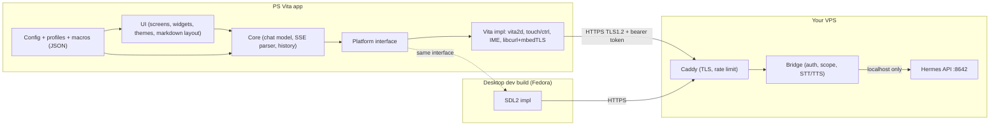

# PS Vita client for Hermes Agent: feasibility and implementation plan (v2)

> [!abstract] TL;DR
> - **Feasible, medium complexity.** Streaming text chat MVP: about 1-2 weekends. Full customizable client with voice: about 7-9 weeks part-time.
> - **Your VPS setup changes the hard problem.** The Vita must reach Hermes **over the internet, so HTTPS is mandatory**, not optional. The Vita's built-in SSL stack is too old, so the app **ships its own TLS (libcurl + mbedTLS) with its own bundled CA certificates**. A small **bridge behind Caddy** on the VPS gives the Vita a narrow, revocable, rate-limited door into Hermes.
> - **Security matters more than in v1.** A Hermes agent can run tools on your VPS. A lost or cloned Vita token is effectively remote access to that agent. The plan scopes, rotates and revokes tokens. See [[#6. Security model for a public VPS]].
> - **Customization is a first-class design goal**, not an afterthought: JSON config, profiles, themes, button mapping, quick-prompt macros, all editable on the Vita or over FTP, with optional Lua scripting later. See [[#5. Customization architecture]].
> - **English only** simplifies fonts, input and layout a lot. No CJK or complex-script work.
> - **Stack:** C++17, VitaSDK, vita2d, libcurl + mbedTLS, yyjson. A platform-independent core also builds as a desktop SDL2 app on Fedora for fast iteration.

> [!info] What changed since v1
> | Your answer | Effect on the plan |
> |---|---|
> | Vita fully modded, HENkaku, "1.65 / 1.66" firmware | Treated as a good modding firmware (see the firmware note below). Plugins (taiHEN, vitacompanion) and "unsafe homebrew" are available. |
> | Hermes on a **VPS** | HTTPS and auth become core. TLS work moves from a late milestone to M3. Bridge is now **required**, not optional. Security section added. |
> | **English** only | Dropped CJK/emoji font work and multi-language IME concerns. Smaller font assets, simpler text layout. |
> | "I want it customizable" | New customization architecture, config schema, themes, profiles, macros, optional scripting. Milestones re-ordered so config exists before the UI is built out. |

> [!warning] Firmware number
> Vita firmware versions are written **3.xx** (for example 3.60, 3.65, 3.68, 3.74), so "1.65 / 1.66" is most likely **3.65** (or a nearby version). That does not change the plan, but please confirm the exact number with *Settings > System > System Information*. Details that depend on it (permanent Ensō boot vs re-running the exploit each boot, plugin compatibility) should be **verified** against the HENkaku/taiHEN docs for your exact version.

> [!warning] Unverified items
> No existing Hermes Agent client for the 3DS turned up in my search. Hermes API details come from the official repo and third-party integration docs, and Vita API specifics from general knowledge of the VitaSDK ecosystem. Items marked **verify** need checking. The repo was empty, so I have not inspected your Hermes install.

---

## Table of contents

1. [[#1. What we are building]]
2. [[#2. Local dev environment on Fedora]]
3. [[#3. Technology choices]]
4. [[#4. Architecture]]
5. [[#5. Customization architecture]]
6. [[#6. Security model for a public VPS]]
7. [[#7. Limits and how to overcome them]]
8. [[#8. Implementation plan (milestones)]]
9. [[#9. Complexity and effort estimate]]
10. [[#10. Risks]]
11. [[#11. Alternatives considered]]
12. [[#Open questions for you]]
13. [[#Sources]]

---

## 1. What we are building

A homebrew app (`.vpk`) for the PS Vita that is a **thin client for the Hermes Agent running on your VPS**. The Vita does no AI work: it renders a chat UI, streams replies, and gives you a highly configurable way to talk to the agent.

### What Hermes gives us

Hermes Agent (Nous Research) can expose an **OpenAI-compatible HTTP API server**:

| Item | Value | Status |
|---|---|---|
| Enable | `API_SERVER_ENABLED=true` and `API_SERVER_KEY=<secret>` in the Hermes env file, then `hermes gateway` | per Open WebUI docs, **verify** |
| Default port / bind | `8642`, `127.0.0.1` (localhost only) | **verify** |
| Base URL | `http://127.0.0.1:8642/v1` on the VPS | **verify** |
| Auth | `Authorization: Bearer <API_SERVER_KEY>`. Keys under 16 characters reportedly make the API silently not serve. | **verify** |
| Endpoints we need | `GET /v1/models` (or a health route), `POST /v1/chat/completions` with `"stream": true` (SSE) | **verify** |
| Sessions | Unknown whether Hermes keeps server-side context per client. Fallback: the client resends the message list each call. | **verify** |

> [!tip] Good news for the VPS case
> Hermes binds to localhost by default. **Keep it that way.** Only the bridge and Caddy face the internet; Hermes itself is never exposed directly.

### Feature tiers

| Tier | Features |
|---|---|
| **MVP** | Settings (host, token), on-screen keyboard, streamed replies over HTTPS, scrollback, "new chat" |
| **v1** | **Customization layer** (profiles, themes, button mapping, quick prompts), saved conversations, basic Markdown, error/reconnect handling, power saving |
| **v2** | Voice input (Vita mic, STT on the VPS), TTS playback, camera/image attach, tool-activity status |
| **v3** | Lua scripting for custom commands and widgets, approve/deny agent actions from the Vita, rear-touch and gyro gestures, notifications |

---

## 2. Local dev environment on Fedora

Goal: build a `.vpk` on Fedora, push it to the Vita over FTP, launch it, read logs and crash dumps. In parallel, build the same app as a desktop SDL2 binary for fast iteration.

### 2.1 Packages

```bash
sudo dnf install -y \
  git cmake make ninja-build gcc gcc-c++ \
  python3 python3-pip \
  curl wget tar xz bzip2 unzip zip patch \
  pkgconf-pkg-config \
  SDL2-devel SDL2_ttf-devel libcurl-devel \
  lftp
```

- `SDL2-devel`, `SDL2_ttf-devel` and `libcurl-devel` are for the **desktop build** ([[#4. Architecture]]).
- `lftp` is a convenient FTP client for pushing builds.
- If the prebuilt VitaSDK binaries complain about a missing shared library, install the matching compat package (for example `ncurses-compat-libs`) or build the toolchain from the vitasdk buildscripts.

### 2.2 Install VitaSDK

The official route is **vdpm** (VitaSDK Package Manager): it bootstraps a prebuilt toolchain and installs ports of common libraries (libcurl, mbedTLS, freetype, vita2d, ...).

```bash
# 1. Environment (add to ~/.bashrc or ~/.zshrc)
export VITASDK="$HOME/vitasdk"
export PATH="$VITASDK/bin:$PATH"

# 2. Bootstrap the toolchain, then install the library packages
git clone https://github.com/vitasdk/vdpm ~/src/vdpm
cd ~/src/vdpm
./bootstrap-vitasdk.sh
./install-all.sh          # or install only what we need, see below

# 3. Sanity check
arm-vita-eabi-gcc --version
vita-mksfoex 2>&1 | head -1
```

> [!note]
> The vdpm README documents `/usr/local/vitasdk` as the default location; a home-directory path works as long as `VITASDK` is exported. One gist I found says the vdpm-downloaded toolchain can be outdated and recommends autobuilds releases or the buildscripts repo. Check the vdpm README for the current recommended bootstrap before running it.

Libraries for this project: `vita2d`, `libcurl`, `mbedtls`, `zlib`, `freetype`, `libpng`, `libjpeg-turbo`, `yyjson` (or `cjson`). Later: `opusfile` or `libvorbis` (audio), and `lua` (scripting, or vendor the source).

> [!important] TLS on the Vita
> We link **libcurl against mbedTLS** and bundle our own CA file. We do **not** use the console's system SSL library. See [[#7.1 TLS and certificates]]. Before relying on it, confirm which TLS versions and cipher suites the vdpm mbedTLS port supports (TLS 1.2 with ECDHE + AES-GCM is what we need; **verify**).

### 2.3 Project skeleton check

```bash
mkdir -p ~/src/vita-hermes && cd ~/src/vita-hermes
cmake -S . -B build-vita -G Ninja \
  -DCMAKE_TOOLCHAIN_FILE="$VITASDK/share/vita.toolchain.cmake" \
  -DCMAKE_BUILD_TYPE=Release
cmake --build build-vita
```

Minimal `CMakeLists.txt` using the VitaSDK macros:

```cmake
cmake_minimum_required(VERSION 3.16)
if(NOT DEFINED CMAKE_TOOLCHAIN_FILE AND DEFINED ENV{VITASDK})
  set(CMAKE_TOOLCHAIN_FILE "$ENV{VITASDK}/share/vita.toolchain.cmake" CACHE PATH "")
endif()
project(vita_hermes CXX C)
include("$ENV{VITASDK}/share/vita.cmake" REQUIRED)

set(VITA_APP_NAME "Hermes")
set(VITA_TITLEID  "HRMS00001")      # 9 chars, A-Z0-9
set(VITA_VERSION  "00.10")

add_executable(${PROJECT_NAME} src/platform/vita/main.cpp)
target_link_libraries(${PROJECT_NAME} vita2d curl mbedtls mbedx509 mbedcrypto z
  freetype png jpeg SceDisplay_stub SceCtrl_stub SceTouch_stub SceNet_stub
  SceNetCtl_stub SceSysmodule_stub SceCommonDialog_stub SceGxm_stub SceAppUtil_stub
  ScePower_stub SceAudio_stub SceAudioIn_stub)

vita_create_self(${PROJECT_NAME}.self ${PROJECT_NAME})
vita_create_vpk(${PROJECT_NAME}.vpk ${VITA_TITLEID} ${PROJECT_NAME}.self
  VERSION ${VITA_VERSION} NAME ${VITA_APP_NAME}
  FILE sce_sys/icon0.png sce_sys/icon0.png
       sce_sys/livearea/contents/bg0.png sce_sys/livearea/contents/bg0.png
       sce_sys/livearea/contents/template.xml sce_sys/livearea/contents/template.xml
       assets/cacert.pem assets/cacert.pem)
```

(The stub list will change as features land. Treat this as a starting point.)

### 2.4 Getting builds onto the Vita

| Step | How |
|---|---|
| Wi-Fi | 2.4 GHz only. WPA2-PSK works. WPA3-only or 5 GHz-only networks do not. |
| FTP | In VitaShell press `SELECT` to start the FTP server (port `1337`). |
| Push build | `curl -T build-vita/vita_hermes.vpk ftp://<vita-ip>:1337/ux0:/data/`, then install from VitaShell. |
| Faster loop | **vitacompanion** plugin: remote commands (launch, destroy, reboot) over a TCP port, so a script can upload, kill and relaunch without touching the Vita. Check its README for ports/syntax. |
| Logs | A network debug-log plugin (UDP) with `nc -ul <port>` on Fedora, or a log file in `ux0:data/hermes/log.txt`. |
| Crashes | The Vita writes a core dump; copy it back and decode with `vita-parse-core` against the unstripped ELF. Keep the ELF of every tested build. |

A `tools/deploy.sh` does: build, FTP upload, relaunch, tail logs. Written in M1.

### 2.5 Emulator and desktop options

| Option | Use | Caveat |
|---|---|---|
| **Vita3K** | Smoke-test that the VPK boots and draws | Network and IME support partial (**verify**). Not for HTTPS/SSE testing. |
| **Desktop SDL2 build** | Daily work: UI, Markdown, config, HTTPS, SSE against a mock or your real VPS | Not identical to Vita performance/memory. Always re-test on hardware. |
| **Real Vita** | Final truth for speed, memory, touch, battery, TLS | Needs the modded console. |

### 2.6 Editor and tooling

- **VS Code** with clangd and CMake Tools; CMake presets `vita` and `desktop`.
- **Mock Hermes server** (about 50 lines of Python) that replays recorded SSE, so UI work does not burn tokens.
- **Config schema** (JSON Schema) so VS Code validates your `config.json` while you edit it.

---

## 3. Technology choices

| Concern | Choice | Why | Alternative |
|---|---|---|---|
| Language | **C++17** (C-style, no exceptions, no heavy templates) | First-class VitaSDK support, shareable with desktop | C; Rust via the community Vita target (tier 3, more friction) |
| Toolchain | **VitaSDK** | Standard homebrew toolchain | None realistic |
| Build | **CMake + Ninja**, presets | VitaSDK macros (`vita_create_vpk`) | Make |
| Rendering | **vita2d** | Simple 2D, textures, text | vitaGL + Dear ImGui (faster forms, heavier, less control) |
| Text | **FreeType** with bundled Latin TTFs (proportional + monospace) | English-only keeps assets small | Bitmap font (fastest, less pretty) |
| HTTP + SSE | **libcurl** + write-callback SSE parser | Chunked, keep-alive, TLS | Raw `sceNet` (no TLS) |
| TLS | **mbedTLS via libcurl, bundled CA file, TLS 1.2** | System SSL library is too old for a public VPS | `sceSsl` (rejected) |
| JSON | **yyjson** | Small, fast, mutable docs for config writing | cJSON |
| Config | JSON files in `ux0:data/hermes/` + schema | User-editable over FTP, versionable | SQLite (overkill) |
| Scripting (v3) | **Lua 5.4**, vendored source | Tiny, sandboxable, familiar to homebrew users | None / hard-coded macros |
| Text input | **System IME dialog** (`sceImeDialog`) | Only practical system keyboard | Custom touch keyboard (optional later, more customizable) |
| Audio (v2) | `sceAudioIn` / `sceAudioOut`, opusfile | Native | - |
| Server side | **Caddy + small bridge (Python FastAPI or Go)** on the VPS | TLS termination, auth, scoping, STT/TTS, image resize | nginx + custom |
| Desktop dev build | **SDL2 + SDL2_ttf + libcurl** behind the same `Platform` interface | Fast iteration on Fedora | - |

---

## 4. Architecture

### 4.1 System



Key rule: **`core/` and `ui/` never include a Vita header.** All hardware access goes through a small `Platform` interface (draw, text metrics, input events, time, files, HTTP, IME, audio). That is what makes the Fedora SDL2 build possible.

### 4.2 Repo layout

```
vita-hermes/
  CMakeLists.txt  CMakePresets.json
  src/
    core/        # chat model, SSE parser, history, profile manager (no platform includes)
    config/      # loader, schema validation, migration, hot reload
    ui/          # screens, widgets, themes, markdown layout, input mapping
    net/         # HTTP client interface + curl/mbedTLS impl
    script/      # Lua host API (v3)
    platform/
      vita/      # vita2d, controls, touch, IME, audio
      sdl2/      # desktop dev build
  assets/        # fonts, icons, default theme, cacert.pem
  sce_sys/       # icon0.png (128x128), livearea/contents/{bg0.png,template.xml}
  schema/        # JSON Schemas for config, theme, profile, macros
  tools/         # mock_hermes.py, deploy.sh, setup-fedora.sh, gen-token.sh
  bridge/        # FastAPI or Go bridge + Caddyfile + systemd unit
  docs/
```

### 4.3 Streaming flow

1. User types via the IME dialog (or picks a macro) and sends.
2. Core appends the message and starts a worker thread (`sceKernelCreateThread` on Vita, `std::thread` on desktop).
3. Worker does `POST /v1/chat/completions` with `stream: true` through libcurl over HTTPS.
4. Write callback feeds bytes to the SSE parser; each `data: {...}` chunk yields `choices[0].delta.content` into a lock-protected queue; `[DONE]` ends the turn.
5. UI thread drains the queue each frame and re-lays-out only the streaming paragraph.
6. Cancel is a flag checked in curl's progress callback.
7. On network drop mid-stream, keep the partial reply, mark it "interrupted", offer retry or continue.

All networking stays off the render thread.

### 4.4 UI sketch (960x544, touch + buttons)

- Top bar: connection dot, active profile name, model, battery.
- Message list: scroll by touch drag, left stick, D-pad (rear touch optional).
- Bottom bar: text field (tap opens IME), send, quick-prompt button.
- Default mapping: Cross = send, Circle = cancel/back, Triangle = new chat, Square = macros menu, Start = settings. **All remappable** ([[#5. Customization architecture]]).

---

## 5. Customization architecture

Customization is designed in from M2 so every later feature plugs into it instead of hard-coding behavior.

### 5.1 Layers (from easy to powerful)

| Layer | What you can change | How | Milestone |
|---|---|---|---|
| **1. Settings UI** | Server, token, font size, theme, brightness, haptics | In-app screens | M3-M5 |
| **2. JSON config** | Everything in layer 1 plus button map, layout, defaults | Edit `config.json` over FTP or on desktop (schema validated) | M2 |
| **3. Profiles** | Multiple endpoints, tokens, models, system prompts, per-profile theme | `profiles/*.json`, switch in-app | M5 |
| **4. Themes** | Colors, fonts, spacing, bubble style, terminal-style vs bubbles | `themes/*.json` + optional font files | M5 |
| **5. Macros / quick prompts** | One-tap prompts with variables (`{clipboard}`, `{date}`, `{last_reply}`) | `macros.json`, menu on Square | M5 |
| **6. Input mapping** | Remap every button, touch zone, rear-touch gesture to an action | `input.json` | M5 |
| **7. Lua scripting** | Custom commands, pre/post-processing of messages, small widgets | `scripts/*.lua`, sandboxed | v3 |

### 5.2 Data layout on the memory card

```
ux0:data/hermes/
  config.json            # global settings
  input.json             # button / touch / rear-touch mapping
  macros.json            # quick prompts
  profiles/
    main.json            # one per agent/endpoint
    work.json
  themes/
    default.json
    terminal-green.json
  fonts/                 # optional user fonts (TTF)
  history/               # one JSON file per conversation
  scripts/               # Lua (v3)
  log.txt
```

### 5.3 Example files

`config.json`:

```json
{
  "schema": 1,
  "active_profile": "main",
  "theme": "default",
  "ui": { "font_size": 22, "show_battery": true, "auto_scroll": true, "markdown": true },
  "power": { "cpu_mhz": 333, "dim_after_s": 60 },
  "history": { "max_messages_in_memory": 200, "keep_on_disk": true }
}
```

`profiles/main.json`:

```json
{
  "schema": 1,
  "name": "Main agent",
  "base_url": "https://hermes.example.com/v1",
  "token_file": "ux0:data/hermes/secrets/main.token",
  "model": "hermes",
  "system_prompt": "You are talking to me on a PS Vita. Keep answers short.",
  "stream": true,
  "timeout_s": 120,
  "pin_ca": "assets/cacert.pem"
}
```

`macros.json`:

```json
{
  "schema": 1,
  "macros": [
    { "label": "Summarize",  "prompt": "Summarize this in 3 bullets: {last_reply}", "button": "SQUARE+1" },
    { "label": "Status",     "prompt": "Give me a one-line status of my VPS tasks." },
    { "label": "Today",      "prompt": "What should I focus on today? It is {date}." }
  ]
}
```

`input.json` (excerpt):

```json
{
  "schema": 1,
  "buttons": { "CROSS": "send", "CIRCLE": "cancel", "TRIANGLE": "new_chat",
               "SQUARE": "macro_menu", "START": "settings",
               "L": "scroll_page_up", "R": "scroll_page_down" },
  "touch": { "swipe_left_edge": "history_menu" },
  "rear": { "swipe_up": "scroll_up", "swipe_down": "scroll_down" }
}
```

### 5.4 Design rules

- **Every setting has a default**; a missing or broken file never prevents the app from starting (log, fall back, show a toast).
- **Versioned schemas** (`"schema": N`) with migration code, so updating the app does not break your files.
- **Hot reload**: one button combo re-reads config, theme and macros without restarting.
- **Same files on desktop and Vita**: edit on Fedora, FTP over, or sync the folder.
- **Secrets in separate files** (`secrets/*.token`), never in `config.json`, so you can share configs and themes safely.
- **Export/import**: a "bundle" `.zip` of config + themes + macros (not secrets).
- **Scripting sandbox (v3)**: no raw file or socket access; only the host API (`send(text)`, `on_reply(fn)`, `notify(msg)`, `get_profile()`), with time and memory limits.

---

## 6. Security model for a public VPS

> [!danger] Why this matters
> Hermes Agent can use tools on the machine it runs on. Anyone holding a valid Vita token can potentially make that agent act. Treat the Vita as a **low-trust, easily lost device**.

### 6.1 Controls

| Control | Detail |
|---|---|
| **Hermes stays on localhost** | Never bind it to `0.0.0.0` or open port 8642 in the VPS firewall. |
| **Caddy in front** | HTTPS on 443 with a normal Let's Encrypt certificate for your domain. Disable response buffering so SSE streams (`flush_interval -1` on `reverse_proxy`). |
| **Bridge in the middle** | Validates a **per-device token**, allows only the endpoints the Vita needs (`/v1/chat/completions`, `/v1/models`, later `/stt`, `/tts`), caps request size, forwards to Hermes with the real `API_SERVER_KEY` the Vita never sees. |
| **Per-device, revocable tokens** | One token per device/profile, 32+ random bytes, stored hashed on the VPS. Revoke by deleting one entry. `tools/gen-token.sh` creates them. |
| **Rate limiting** | Per token and per IP, plus fail2ban on repeated 401s. |
| **Optional mTLS** | A client certificate bundled on the Vita (mbedTLS supports it) as a second factor. Heavier to manage; recommended if you ever share the VPS with other services. |
| **Agent scoping** | Use a dedicated Hermes profile/toolset for Vita sessions with the riskiest tools off (shell, file deletion, payments) or behind an approval step. Pending approvals can be answered from the Vita in v3. **Verify** what Hermes exposes for this. |
| **Audit log** | Bridge logs token id, timestamp, size, status. No message bodies by default. |
| **Lost Vita plan** | Revoke the token, rotate if mTLS is used, check the audit log. Document it in `docs/`. |
| **Token storage on the Vita** | Plain file on the memory card (the Vita has no secure keystore for homebrew). Mitigated by revocation, scoping and, optionally, a PIN that decrypts the token at app start (v2). |

### 6.2 Caddy snippet (idea)

```caddyfile
hermes.example.com {
    encode zstd gzip
    request_body { max_size 1MB }
    reverse_proxy 127.0.0.1:9000 {     # the bridge, not Hermes
        flush_interval -1              # do not buffer SSE
        transport http { read_timeout 5m }
    }
}
```

TLS defaults in Caddy (TLS 1.2 and 1.3, ECDHE with AES-GCM or ChaCha) work with a TLS 1.2 client. Do not restrict to TLS 1.3 only, or the Vita cannot connect.

---

## 7. Limits and how to overcome them

### Summary table

| # | Limit | Impact | Mitigation |
|---|---|---|---|
| 1 | **TLS / certificates**: system SSL library is old | Cannot trust modern HTTPS sites | libcurl + mbedTLS, TLS 1.2, **bundled CA file**, correct Vita clock (see 7.1) |
| 2 | **No VPN/Tailscale** on Vita | Cannot use private networking | Public HTTPS endpoint with token + rate limits ([[#6. Security model for a public VPS]]) |
| 3 | **Memory**: 512 MB total; homebrew gets a slice and the heap must be requested | Big histories/textures crash | Set heap in code, cap in-memory history, page to disk, small texture atlases |
| 4 | **CPU**: 333 MHz default, up to 444 MHz | Heavy Markdown layout stutters | Incremental layout, raise clock only when needed |
| 5 | **Text input**: no keyboard | Long prompts hurt | IME dialog, **macros**, voice (v2), companion web page |
| 6 | **Screen**: 960x544 | Wide code/tables unreadable | Horizontal scroll for code, simplified tables, bridge can condense output |
| 7 | **Fonts** (English only) | Emoji/unusual glyphs show as boxes | Bundle a Latin font + symbols; bridge replaces emoji with text like `:smile:` |
| 8 | **Suspend on PS button** | Streaming dies when you leave | Keep partial reply; "interrupted" state; resume/retry |
| 9 | **Wi-Fi: 2.4 GHz, unstable roaming** | Dropped streams on the go | Timeouts, retry with backoff, resumable turns where Hermes allows (**verify**) |
| 10 | **Battery** | Short sessions | Dimming, idle frame rate, no polling |
| 11 | **Latency to VPS** | Slow first token | Keep-alive connections, small payloads, optional "typing" indicator from first byte |
| 12 | **Hermes API unknowns** (sessions, tool events) | Protocol tweaks | M0 spike against your real server before UI work |
| 13 | **Modded console only** | Not for stock Vitas | Fine for you; document requirements if you publish |
| 14 | **Old Vita browser** | Cannot reuse web UIs | Native app |

### 7.1 TLS and certificates

The plan for HTTPS to your VPS:

1. **Caddy gets a Let's Encrypt certificate** for `hermes.yourdomain`.
2. The app bundles `assets/cacert.pem` containing the roots we need (at minimum the ISRG Root X1 chain; a trimmed Mozilla bundle is fine). **Verify** the exact chain your certificate uses; Let's Encrypt has changed intermediates over time.
3. libcurl options: `CURLOPT_CAINFO` = bundled file, `CURLOPT_SSL_VERIFYPEER=1`, `CURLOPT_SSL_VERIFYHOST=2`, `CURLOPT_SSLVERSION=CURL_SSLVERSION_TLSv1_2` (minimum).
4. **Verify the hostname** and never fall back to "insecure" mode. A debug-only switch may exist in the desktop build only.
5. **Clock**: certificate validation needs a correct date. The Vita's clock can drift or reset; the app warns clearly on "certificate not yet valid / expired" instead of showing a generic network error.
6. **Pinning option**: a profile can pin your own CA or the server's public key hash (`CURLOPT_PINNEDPUBLICKEY`) for an extra layer, at the cost of updating the app when you rotate keys.
7. **Fallback if the mbedTLS port cannot do what we need**: terminate TLS with a certificate from a private ECDSA CA (bundled in the app), or, worst case, use a dedicated TLS 1.2-friendly front proxy. Decide in M0/M3 based on a real test.

> [!tip] First proof to run (M0 desktop, M3 Vita)
> `curl --tlsv1.2 --tls-max 1.2 https://hermes.yourdomain/v1/models -H "Authorization: Bearer ..."` from Fedora, then the same from the Vita app. If both work, the architecture is proven.

### 7.2 Text input beyond the IME

- **Macros** (customization layer 5): the fastest fix for repeated prompts.
- **Voice** (v2): Vita mic to 16 kHz mono PCM, upload to the bridge, STT (for example Whisper) on the VPS, transcript sent to Hermes.
- **Companion page**: the bridge serves a small authenticated web page; type on a phone or PC and the text lands in the Vita's active chat.

### 7.3 Output beyond text (v2)

- **TTS**: bridge synthesizes Opus/OGG; Vita decodes with opusfile and plays via `sceAudioOut`.
- **Images**: bridge downscales to at most 960x544.
- **Code blocks**: monospace, horizontal scroll, optional simple syntax colors from the theme.

---

## 8. Implementation plan (milestones)

Times assume part-time work by one developer comfortable with C/C++. Milestones are reordered versus v1 so that **HTTPS** and **config** come before UI polish.

### M0 - Spike and de-risk (1-2 days)

- [ ] On the VPS: enable the Hermes API server (localhost only), note version and settings.
- [ ] Put Caddy in front (HTTPS, no buffering) and test streaming from Fedora with `curl`.
- [ ] Record raw SSE output into `docs/samples/`; write `tools/mock_hermes.py` that replays it.
- [ ] Confirm session behavior (server-side context or resend history) and what the stream shows during tool use.
- [ ] Decide bridge implementation (FastAPI vs Go) and write the minimal token-checking bridge.
- [ ] Confirm exact firmware, FTP and plugin setup on the Vita.

**Exit:** protocol notes written; HTTPS streaming proven from the desktop; bridge skeleton running.

### M1 - Toolchain and hello world on hardware (1 day)

- [ ] Install VitaSDK on Fedora ([[#2. Local dev environment on Fedora]]).
- [ ] Draw text with vita2d, read buttons and touch, exit cleanly.
- [ ] `tools/deploy.sh`: build, upload, relaunch, tail logs.
- [ ] LiveArea assets.

**Exit:** a branded app launches from the LiveArea and reacts to input.

### M2 - Platform layer and config system (2-3 days)

- [ ] `Platform` interface with SDL2 and Vita backends; CMake presets.
- [ ] Config loader: defaults, schema validation, migration, hot reload, logging of bad files.
- [ ] Basic widgets: label, scroll view, button, text field.

**Exit:** same UI on Fedora and Vita, driven by `config.json`.

### M3 - HTTPS and streaming (3-4 days)

- [ ] libcurl + mbedTLS build on the Vita; bundled CA file; TLS 1.2 test against your VPS.
- [ ] SSE parser with unit tests (split chunks, multi-line data, `[DONE]`, bad JSON), run on desktop.
- [ ] Worker thread, timeouts, cancel, retry with backoff.
- [ ] Minimal profile (base URL, token file) and connection test.
- [ ] Streamed replies shown in the message list.
- [ ] Clear TLS error messages (clock, certificate chain, hostname).

**Exit:** real streamed answers from your VPS over HTTPS on the Vita. **This is the MVP.**

### M4 - Input and UX basics (2-4 days)

- [ ] `sceImeDialog` integration (UTF-8/UTF-16, cancel).
- [ ] Touch and stick scrolling, auto-scroll that stops when you scroll up.
- [ ] Error states: Wi-Fi off, 401, timeout, server down, clock wrong.
- [ ] Font size, battery indicator.

**Exit:** usable for real conversations.

### M5 - Customization layer (4-6 days)

- [ ] Profiles (multiple endpoints/tokens/models/system prompts), in-app switcher.
- [ ] Themes (colors, fonts, bubble vs terminal style), live preview.
- [ ] Macros menu with variables.
- [ ] Input mapping from `input.json`, including rear touch.
- [ ] Bundle export/import; JSON Schemas published in `schema/`.

**Exit:** you can reshape the app without rebuilding it.

### M6 - History, Markdown and security hardening (4-6 days)

- [ ] Persist and manage conversations.
- [ ] Minimal Markdown: headings, bold/italic, inline code, fenced code, lists, links as text.
- [ ] Memory caps and paging.
- [ ] Bridge: per-device hashed tokens, rate limits, audit log, revoke tooling, systemd unit, fail2ban.
- [ ] Optional token PIN and optional mTLS.

**Exit:** v1. Safe enough to leave on a public VPS.

### M7 - Voice and media (1-2 weeks)

- [ ] Mic recording, upload, STT on the VPS.
- [ ] TTS playback.
- [ ] Camera / image attach, resized on device or bridge.

**Exit:** hands-free-ish chat with the agent.

### M8 - Scripting and agent features (1-2 weeks, optional)

- [ ] Embedded Lua with the sandboxed host API; example scripts.
- [ ] Tool-activity status line; approve/deny pending agent actions (depends on Hermes, **verify**).
- [ ] Notifications when a long task finishes.

**Exit:** the Vita becomes a programmable remote for your agent.

---

## 9. Complexity and effort estimate

| Scope | Effort (part-time) | Difficulty | Notes |
|---|---|---|---|
| MVP (M0-M3) | ~2 weekends, 35-50 h | Medium | Extra time versus v1 for HTTPS, bridge and Caddy |
| v1 (M0-M6) | ~4-6 weeks | Medium | Customization, layout and hardening are the long poles |
| v2 (M7) | +1-2 weeks | Medium-high | Audio APIs and codecs are fiddly |
| Full (M0-M8) | ~7-9 weeks | Medium-high | Depends on what Hermes exposes for approvals/tool events |

**Why it is manageable:** the Vita runs no AI; HTTP + SSE is simple; VitaSDK packages libcurl, mbedTLS, freetype and vita2d; English-only removes font and input complexity.

**Where the difficulty is:** TLS on a 2011 console, Vita-specific plumbing (IME, threads, suspend, memory), and designing a config system that stays coherent as features grow.

---

## 10. Risks

| Risk | Likelihood | Impact | Response |
|---|---|---|---|
| mbedTLS port cannot connect to your server (version, ciphers, cert chain) | Medium | High | Prove it in M0/M3; fallback proxy or private CA ([[#7.1 TLS and certificates]]) |
| Stolen/lost Vita token gives agent access | Medium | High | Scoped agent profile, per-device tokens, revoke, rate limit, optional mTLS/PIN |
| Hermes API differs from assumptions | Medium | Medium | M0 spike before UI work |
| SSE buffered by a proxy, replies arrive in one lump | Medium | Medium | `flush_interval -1`, test through the full chain |
| Wrong Vita clock breaks certificate validation | Medium | Low | Detect and explain; offer a settings hint |
| Config sprawl becomes confusing | Medium | Medium | Schemas, defaults, migrations, docs, example bundle |
| Memory crashes from long chats | Medium | Medium | Heap config, caps, paging |
| Scope creep | High | Medium | Tiers and milestones are explicit; MVP first |
| Firmware/plugin differences | Low | Medium | Confirm exact firmware (M0); pin tool versions in `setup-fedora.sh` |

---

## 11. Alternatives considered

| Option | Verdict |
|---|---|
| **Vita web browser + a tiny server-rendered chat page** | Cheap network-path prototype, but the browser's TLS and rendering are old, so on a public HTTPS VPS it will likely fail. Not recommended now. |
| **Lua-only homebrew** (LPP-Vita and similar) | Fast UI prototyping, weaker HTTP/TLS/streaming; hard to share code with a desktop build. We use Lua only as an add-on (v3). |
| **Rust** (community Vita target) | Appealing but tier-3 and a thinner ecosystem. Revisit if you prefer Rust. |
| **vitaGL + Dear ImGui** | Quick forms; less control over chat layout and theming. Possible for settings screens only. |
| **No bridge, expose Hermes directly through Caddy** | Simpler, but the Vita would hold the real Hermes key and have full API reach. Rejected for security. |

---

## Open questions for you

> [!question] Answer inline or reply with the numbers. Defaults in brackets are what I will assume.

1. **Exact firmware** from *Settings > System > System Information* [assume 3.65]. Is Ensō installed (permanent) or do you re-run the exploit after each boot?
2. **VPS details**: OS, do you already have a **domain name** for it, and is Caddy/nginx already running there? [assume Linux + a domain you can point at it]
3. **Hermes version** and whether the API server is already enabled. [assume not yet]
4. **Voice** (mic input, spoken replies): needed soon or later? [later, v2]
5. **Customization priorities**: which of these matter most? Themes, macros, profiles, button mapping, scripting. [all, in the order of section 5]
6. **UI default look**: chat bubbles or retro terminal style? [both via themes, bubbles first]
7. **Language**: C++17 [assume yes] or would you rather use C or Rust?
8. **Agent safety**: should Vita sessions get a restricted Hermes toolset, with risky actions requiring approval? [yes]
9. **Distribution**: personal use only, or publish the VPK and bridge? [personal first, publishable structure]
10. **Bridge language**: Python/FastAPI (quicker to hack) or Go (single binary)? [Python first]

---

## Next step after your feedback

I would start with **M0 + M1**: `tools/setup-fedora.sh`, CMake presets, a mock Hermes server, the minimal bridge plus Caddyfile for your VPS, and a hello-world VPK with one-command deploy.

---

## Sources

- Hermes Agent repo: <https://github.com/NousResearch/hermes-agent>
- Open WebUI, connecting Hermes Agent (API server settings): <https://docs.openwebui.com/getting-started/quick-start/connect-an-agent/hermes-agent>
- Dokploy Hermes template: <https://docs.dokploy.com/docs/templates/hermes>
- VitaSDK vdpm: <https://github.com/vitasdk/vdpm>
- 3DBrew (3DS homebrew reference): <https://www.3dbrew.org>
- Vita-specific API details (IME dialog, audio-in, heap-size symbol, `vita-parse-core`, vitacompanion, mbedTLS capabilities, firmware/Ensō specifics) come from general knowledge of the VitaSDK ecosystem and were **not** re-verified in this session. Confirm against the VitaSDK docs, HENkaku/taiHEN docs and plugin READMEs.
